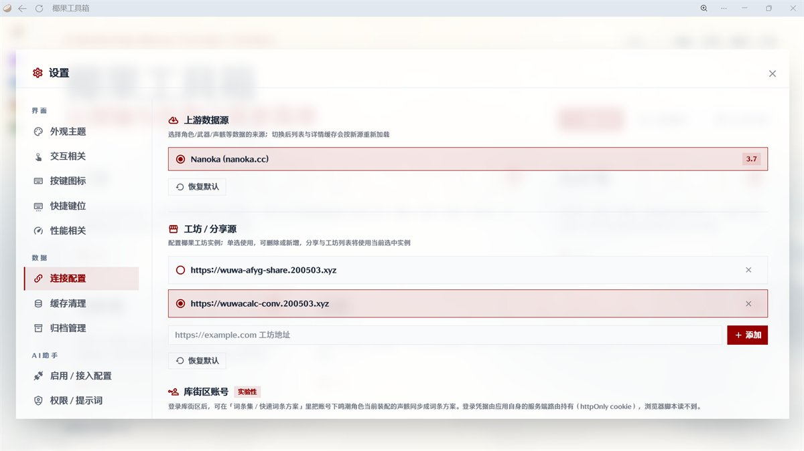

# WuwaCalc-Conv · 椰果工坊 · 鸣算屋转接器

把 [鸣算屋](https://wuwacalc.cn) 的方案数据翻译成**椰果工坊 / 椰果工具箱**认得的格式，让工具箱能直接浏览、导入鸣算屋的工程。

- **列表接口**：`/api/public/projects` 转发到鸣算屋 `/api/public-schemes`，响应体按工坊「工程广场」的字段口径转换。
- **下载接口**：`/share/{code}/download` 取方案详情，把**队伍配置、排轴、拉表、词条/环境配置**四个阶段分别转换后合成椰果工程文件（`{ version, exportedAt, project }`），当附件下载。
- **主页**：`GET /` 是鸣算屋工程广场的展示页（服务端渲染，无前端框架、无外部资源）。

## 使用方法

在椰果工具箱主页点击 **设置 - 连接配置**，在 **工坊 / 分享源** 输入 `https://wuwacalc-conv.200503.xyz` 新建配置，然后切换到新建的配置。
此时「从工坊导入」便会展示鸣算屋的方案列表并可供下载。



> 相关设置截图

## 端点

| 方法 | 路径 | 说明 |
| --- | --- | --- |
| `GET` | `/api/public/projects` | 工坊列表口径：`page` / `perPage` / `sort` / `q` |
| `GET` | `/share/{code}/download` | 下载转换后的椰果工程文件 |

## 开发

```sh
deno task dev     # 本地起 wrangler dev
deno task test    # 单元测试
deno fmt src && deno lint src && deno check src/
```

上游基址可用 `WUWACALC_API_BASE` 覆盖（默认 `https://wuwacalc.cn`）。

换主页上的使用方法截图（同时更新 `assets/` 与内联进 worker 的副本）：

```sh
deno run -A scripts/build-usage-images.ts <暗色截图> <亮色截图>
```

输入建议压到 1200px 宽的 JPEG（单张约 70KB）。

## 文档

字段级映射规则（乘区对照、`ratio` 与伤害条目 id、轮次与参考线、叠层拆条）见
[`docs/convert-phase-mapping.md`](docs/convert-phase-mapping.md)。

## 说明

- 数据来自鸣算屋公开接口，仅供学习交流；转换结果可能有偏差，请以鸣算屋原站为准。
- 详情接口单条可达 MB 级、实测 27~66s 才返回，因此下载侧做了边缘缓存 + 快速失败重试 + 旧副本兜底。
